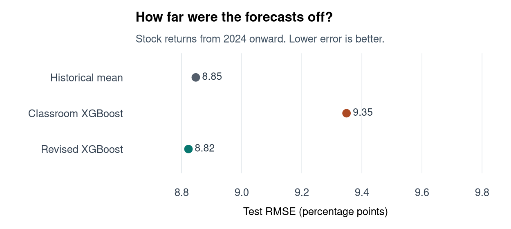
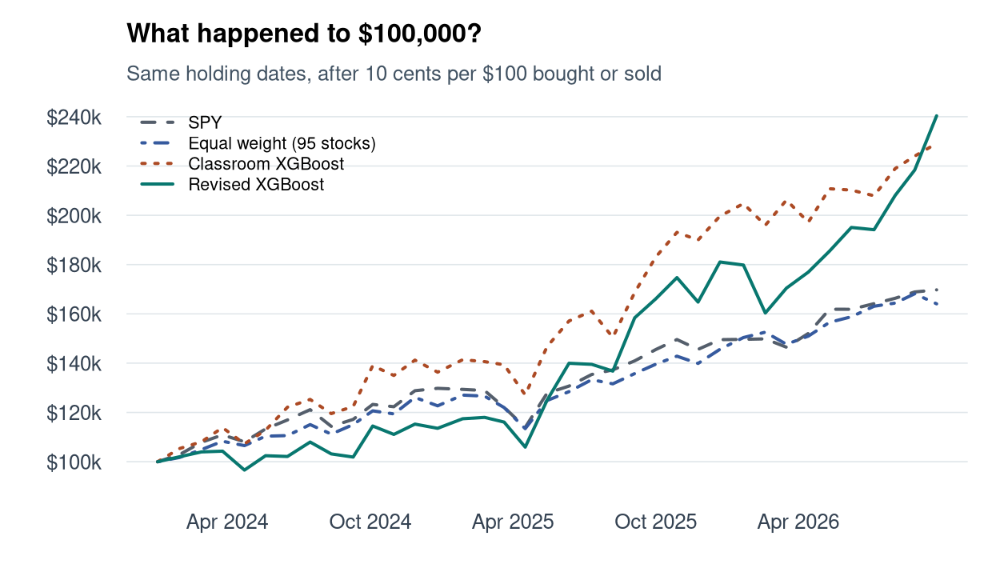

In the Fall 2026 stock game, each team started two portfolios with $100,000. The indicator-based portfolio finished ahead of the intuition-based one for **@@GAME_WINS@@ of @@GAME_N@@ teams**, by **@@GAME_GAP@@ on average**. That tells us what happened in one game. It leaves a harder question: **Can a model pick winners on new data, and can those picks beat a fund you could simply hold?**

## What I kept from class

The classroom XGBoost script predicts stock returns from price and volume, recent gains, volatility, and daily performance relative to SPY. It adds 300 decision trees, each trying to correct previous errors, then ranks the stocks by predicted return. The handout's example shows the strategy ahead of SPY. I wanted to see how it would do over matching investment dates and after trading costs.

I kept the original model's inputs and settings. I also kept its target: the return from the close one trading day after the signal to the close twenty trading days after it. That's 19 trading sessions of price changes. To prevent information from crossing the split, I excluded training observations whose returns weren't complete by the end of 2023. I used the same 95 stocks listed in the script and a [frozen price snapshot](https://github.com/Johnbrick123/sp500-data/releases/tag/snapshot-2026-11) based on Yahoo Finance data.

## A smaller model

A price of $150 means something different for Apple and a different company. A 10% gain is easier to compare. The revised model uses returns, measures of trading activity relative to each stock's norm, and ranks for momentum and volatility. It skips raw price and volume levels and makes its trees shallower, giving the model fewer ways to fit noise. I chose **@@TREES@@ trees of depth @@DEPTH@@** using only a validation period in 2023, then refit both models on the eligible pre-2024 data and froze them.

{fig-alt="Test forecast error was @@RMSE_MEAN@@ percentage points for the historical mean, @@RMSE_OLD@@ for the classroom model and @@RMSE_NEW@@ for the revised model."}

On **@@NFORECASTS@@** stock and date pairs from 2024 onward, the classroom model's root mean squared error was **@@RMSE_OLD@@ percentage points**. The revision reduced it to **@@RMSE_NEW@@**, barely below the **@@RMSE_MEAN@@** from predicting the same historical average for every stock. Meanwhile, the average daily correlation between predicted and realized stock rankings rose from **@@RANK_OLD@@ to @@RANK_NEW@@**. That's a small signal. Surprise earnings and broad market shocks can overwhelm the patterns in past prices, and relationships learned in one market can fade in another. The daily forecast windows also overlap, so the forecast count is not a count of independent bets.

## Could you make money from the rankings?

Starting with $100,000, I used the class rule for both models: take the ten highest forecasts and allocate in proportion to their positive values. I compared them with buying and holding SPY and with rebalancing an equal-weight portfolio of the same 95 stocks. All strategies used the same **@@WINDOWS@@** consecutive holding periods, from @@FIRST_DATE@@ to @@LAST_DATE@@. I charged 10 cents per $100 bought or sold.

{fig-alt="Ending wealth was @@NEW_NET@@ for the revised model, @@OLD_NET@@ for the classroom model, @@EQUAL_NET@@ for equal weight, and @@SPY_NET@@ for SPY."}

After costs, the revision ended at **@@NEW_NET@@**, ahead of the classroom model (**@@OLD_NET@@**), equal weight (**@@EQUAL_NET@@**), and SPY (**@@SPY_NET@@**). The revision only overtook the classroom strategy in the final holding period. It still fell **@@NEW_DD@@** from a previous high at one of the observed period ends. The final lead held when I raised costs to 25 cents per $100 traded.

**Takeaway:** A small improvement in ranking stocks was worth money in this test, even though the revised model barely beat a historical average at forecasting return sizes. The gap doesn't establish a lasting edge. The test covers fewer than three years; the fixed list favors companies known to have survived, the portfolios can concentrate in a few stocks, and the backtest does not adjust for differences in risk or include taxes.

[Code, data and replication](https://github.com/augenstern118/testrepo/tree/main/blog/posts/post9) · [Forecast metrics](results/forecast_metrics.csv) · [Portfolio results](results/portfolio_metrics.csv) · [Trading cost sensitivity](results/cost_sensitivity.csv)
